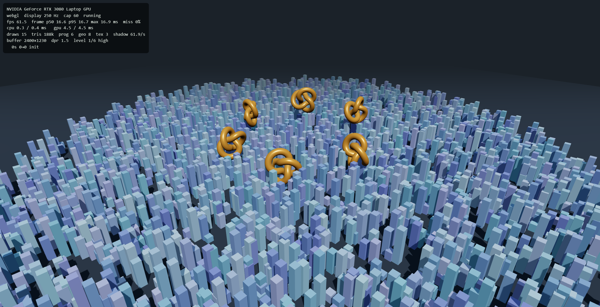
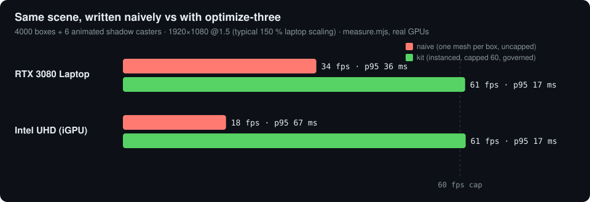
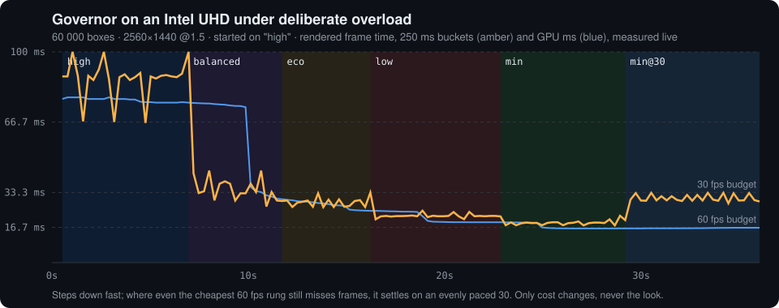
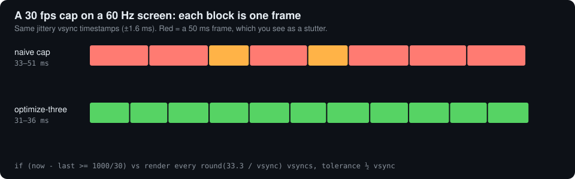
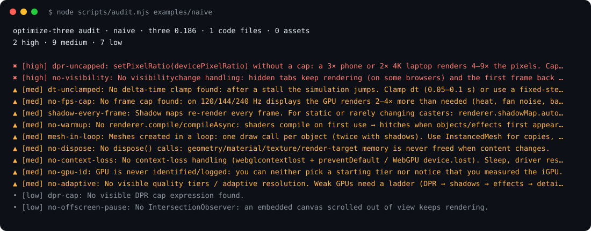
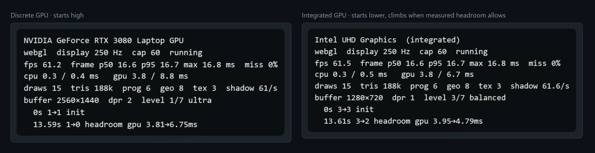

# optimize-three

**Your three.js scene runs at 60 fps on your desktop. On the laptops your visitors use, it may not.**

`optimize-three` is an agent skill (Claude Code, Codex, any SKILL.md-aware agent) plus a dependency-free
kit. It makes browser 3D (three.js, React Three Fiber, WebGL2, WebGPU) run well on real hardware,
including office laptops with Intel/AMD integrated GPUs. It does the boring, always-necessary work
in every project, so you don't have to remember it.



<p align="center">
  
</p>

The scene is identical in both bars. The left bars show it written the way most posted demos are:
one mesh per object, uncapped DPR, uncapped rAF, shadows redrawn every frame. The right bars show the
same scene with the kit and the skill's rules applied. Measured with the included `measure.mjs` on real
GPUs at 1920×1080 with 150 % scaling.

## What it does for you

| | |
|---|---|
| **Measures on the right GPU** | Logs the actual GPU. `measure.mjs` runs your page on the discrete **and** the integrated GPU, so you can't ship "60 fps" measured on the wrong chip. |
| **Quality that adapts, without ping-pong** | A ladder that removes the least visible cost first, and a governor that falls fast, rises slowly and bans levels that just failed. Under a cap it reads GPU ms, not fps. |
| **Frame cap with even pacing** | 60 by default, a steady 30 as the last resort. Frames land on whole vsyncs, so you never get a 16/33/50 ms stutter mix. |
| **Sleeps when nothing changes** | Render on demand for viewers and configurators: 0 fps idle. It also pauses on hidden tabs and off-screen canvases. |
| **No first-click freeze** | Warms up every shader variant (canvas *and* render targets) and uploads textures before the first frame. |
| **Static stays static** | A shadow-map cache redraws only when a caster or light changes. |
| **Robust** | Handles context loss, page lifecycle and disposal. A `?perf` HUD, `?q=` / `?dpr=` / `?fps=` overrides, and a hint for Windows users whose browser runs on the power-saving GPU. |

<p align="center">
  
</p>

<p align="center">
  
</p>

## What's inside

```
skills/optimize-three/
├── SKILL.md            workflow, 10 non-negotiables, budgets; the agent loads this
├── references/         9 numbers-first guides (measurement, adaptive quality, frame loop, GPU tiers,
│                       WebGL vs WebGPU, scene cost, lighting/shadows/post, stalls, showcase checklist)
├── kit/                drop-in ES modules, three.js as peer (see kit/README.md)
├── scripts/audit.mjs   static scan of an existing project, seconds
├── scripts/measure.mjs real-GPU measurement (dGPU + iGPU) via installed Chrome
└── templates/          Chrome launcher that forces the discrete GPU (Windows)
```

<p align="center">
  
</p>

Everything here was distilled from about 25 production showcases, configurators and a browser flight
game, each tuned on an RTX laptop *and* an Intel UHD iGPU. Every rule in it was learned from a
regression on real hardware.

## Install

### Claude Code
```
/plugin marketplace add maxliebscher/optimize-three
/plugin install optimize-three@optimize-three
```
Or copy `skills/optimize-three/` to `~/.claude/skills/` (all projects) or `<project>/.claude/skills/`.

### Codex
```bash
codex plugin marketplace add maxliebscher/optimize-three
```
Or copy `skills/optimize-three/` to `~/.agents/skills/` (all projects) or `<project>/.agents/skills/`.
Invoke it with `$optimize-three`, or let Codex pick it when the task matches.

### Other agents (Cursor, Copilot, Gemini CLI, …)
Point your rules/`AGENTS.md` at `skills/optimize-three/SKILL.md`. The kit and scripts are plain JS and
work without any agent.

## Use

Just work on your 3D project. The skill triggers on fps, stutter, iGPU, quality levels, WebGPU,
shadows, loading hitches, "make it run everywhere"… Or ask directly:

> "Optimize this scene for laptops." · "Add quality levels and adaptive resolution." ·
> "Why does it freeze on the first click?" · "Should we move to WebGPU?" · "Make this showcase release-ready."

Run the tools yourself:

```bash
node skills/optimize-three/scripts/audit.mjs ../my-3d-project
npm i -D playwright-core
node skills/optimize-three/scripts/measure.mjs http://localhost:5173/ --gpu=both
```

### Measurement semantics

`measure.mjs` reports **render fps** separately from **raf Hz**. Render FPS is the change in
`window.__perf.report().frames` divided by the actual measurement duration (after warmup).
A sleeping scene therefore measures **0 render FPS**, even while the observer's rAF runs at 60 Hz.
Demand rendering includes idle time; it reports throughput over the whole window, not burst smoothness.

Without a cumulative render counter or the explicit hook below, render FPS is **not measured**
(`–` in the table; `renderFps: null`, `renderFrames: null`, `renderSource: "unmeasured"` in JSON).
The script cannot reliably infer application frames from WebGL drawcalls, postprocessing passes,
offscreen renders, or rAF callbacks. It does not automatically wrap Three.js renderers.

For an application without the kit, call this once after each complete application frame:

```js
renderer.render(scene, camera); // or the entire composer / awaited async render
window.__measure?.recordRenderFrame();
```

Call the hook during warmup too, including the initial frame of a static/demand scene. Otherwise the
script cannot distinguish an idle instrumented app from one that never installed the hook and
marks that first measurement window unmeasured. Count one frame after all passes, not one per pass.

Existing JSON fields (`rafFps`, `rafP50/P95/Max`, `perf`, GPU string, validity, errors, heap and long
tasks) remain. New fields are `renderFps`, `renderFrames`, `renderSource`, `measurementMs`,
`renderIntervalMs` (hook intervals; null when unavailable) and `perfError`.
Nested `perf.fps`, kit interval/CPU/GPU samples and miss rates are the kit's existing rolling report;
they may include warmup or pre-idle frames. Use top-level `renderFps` for measurement-window comparisons.
Hook interval percentiles are null with fewer than two frames. A reset/replaced kit counter is
unmeasured. Render counting measures completed application callbacks, not GPU completion or frames
actually presented by the display. GPU timer readings retain their existing meaning.

The observer itself keeps rAF active and adds measurement overhead. Use a foreground headed browser
for display pacing, and keep camera/input sequences identical between comparisons.
See [measurement limits](skills/optimize-three/references/measurement.md).

Tests: `npm test` runs dependency-free clock/kit and CLI regressions. For the additional real-browser
smoke test, install `playwright-core`, run `npx playwright-core install chromium`, then
`MEASURE_BROWSER_TESTS=1 npm test` (set the environment variable equivalently on Windows).
The smoke test verifies frame counting, not real-GPU performance.

Minimal kit wiring:

```js
import { detectGpu, createRenderer, createPerfKit, defaultLadder, startIndexForTier,
         applyPixelRatio, setShadowMapSize, warmup } from './kit/index.js';

const profile = detectGpu();                       // GPU string, class, starting tier, URL overrides
const { renderer } = await createRenderer({ canvas });
const levels = defaultLadder();                    // extend levels with your own fields
const kit = createPerfKit({
  renderer, scene, camera, profile, levels, mode: 'demand',
  start: startIndexForTier(levels, profile.tier),
  apply: (l) => { applyPixelRatio(renderer, l.dpr); setShadowMapSize(sun, l.shadow, renderer); },
  render: ({ dt }) => { const moving = controls.update(dt); renderer.render(scene, camera); return moving; },
});
await warmup({ renderer, scene, camera });         // behind your loader
kit.start(); kit.ready();
```

Open your page with `?perf` for the HUD. `?q=low|mid|high`, `?dpr=`, `?fps=30` and `?bench` make any
measurement reproducible, and `window.__perf.report()` returns the numbers as JSON.

<p align="center">
  
</p>

## Examples

```bash
npm run serve
# http://localhost:5180/examples/basic/?perf    the kit       (?mode=demand, ?fps=30, ?q=low, ?n=60000)
# http://localhost:5180/examples/naive/         the baseline  (how not to do it)
```

## Tests

```bash
npm test
```
The tests cover GPU classification against real ANGLE/Firefox/Safari strings, governor stability (no
oscillation, bans, probing), even pacing on 60 and 144 Hz, demand-mode sleeping, suspend reasons,
fixed-step independence, and manual stepping. `node docs/make-images.mjs` regenerates every image in
this README from real runs.

## Facts and versions

Backend facts were checked in October 2026 against three r186:
- `RenderPipeline` rename
- `PCFSoftShadowMap` removal
- `renderAsync` deprecation
- WebGPU support per browser
- Chrome ignoring `powerPreference` on Windows

Found something outdated? Open an issue with a link.

## License

MIT
